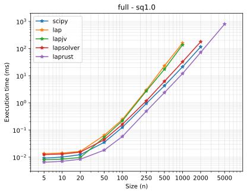
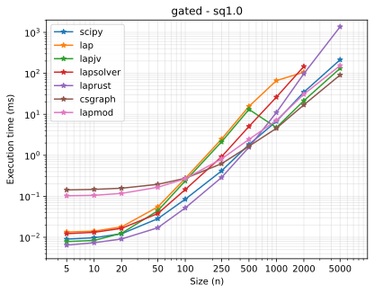
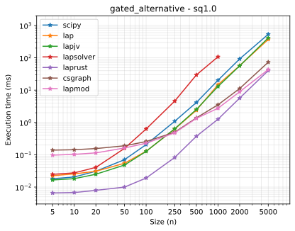

# Pylapy

[](https://github.com/raphaelreme/pylapy/raw/main/LICENSE)
[](https://pypi.org/project/pylapy/)
[](https://pypi.org/project/pylapy/)
[](https://pypi.org/project/pylapy/)
[](https://codecov.io/github/raphaelreme/pylapy)
[](https://github.com/raphaelreme/pylapy/actions/workflows/tests.yml)

**pylapy** is a thin, unifying wrapper around the fast Linear Assignment Problem (LAP) solvers available in
Python. The LAP matches the rows and columns of a cost matrix one‑to‑one so as to **minimize the total
cost** — the core of problems like object tracking, bipartite graph matching and
resource allocation.

A single class, `pylapy.LapSolver`, exposes one interface (`solve` / `sparse_solve`) over several backends
(all shipped by [lapx](https://github.com/rathaROG/lapx) and [scipy](https://scipy.org/)) and adds what
real problems need on top of the raw solvers:

- **rectangular** matrices ($N \neq M$),
- `inf` (impossible) entries,
- a **`cost_limit`** to discard over-costly links,
- an **`alternative_cost`** to leave a row/column unmatched,
- a **`sparse_solve`** path for thresholded/sparse problems.

The core only depends on `numpy`; every backend is an optional dependency.

## Why pylapy?

- **One API, any backend.** Switch solver (or let pylapy auto-pick the fastest installed one) without
  touching your code. On the same problem one backend can be **10×+ faster** than another — pylapy lets you
  find and use the best.
- **Dense and sparse, one interface.** Both dense and sparse LAP solving live behind the same unified API
  (`solve` / `sparse_solve`): keep the full cost matrix with `solve`, or drop forbidden links and solve on
  the sparse structure with `sparse_solve` — same inputs, same `(L, 2)` link output.
- **Handles the messy cases for you.** Rectangular shapes, infeasible links, thresholds and "leave it
  unmatched" costs are all handled by rewriting the cost matrix under the hood (see *How it works*).
- **Real runtime wins.** Picking the right dense backend (`laprust`) already helps; and when your matrix is
  sparse or thresholded, `sparse_solve` is typically **~10–25× faster** than a dense solve. See
  [the benchmark](benchmark/benchmark.md).

## Install

```bash
pip install pylapy          # core only (numpy) — no solver backend yet

# Install a specific backend: lap, lapjv, lapsolver, laprust (dense) & lapmod, csgraph (sparse)
pip install pylapy[lap]     # lap is now shipped via lapx (https://github.com/rathaROG/lapx)
pip install pylapy[csgraph] # scipy + numba for handling sparse matrix.

# Install all backends
pip install pylapy[all]     # lapx + scipy + numba (all backends and sparse support)
```

We rely on `lapx` that now ships prebuilt wheels for many Jonker–Volgenant implementations on all common platforms and on `scipy` which works works everywhere and also provide a dense and a sparse implementation of JV.


## Getting started

```python
import numpy as np
import pylapy

rng = np.random.default_rng(0)
dist = rng.random((2000, 1800))  # rectangular is fine

solver = pylapy.LapSolver()  # auto-pick the fastest installed backend
# solver = pylapy.LapSolver("scipy")   # ... or force one: "laprust" | "lap" | "lapjv" | "scipy" | "lapsolver"

links = solver.solve(dist)  # full assignment -> (L, 2) array of matched (row, col)
links = solver.solve(dist, cost_limit=0.1)  # forbid links above 0.1
links = solver.solve(dist, alternative_cost=0.1)  # a row/column may stay unmatched at cost 0.1
links = solver.sparse_solve(dist, cost_limit=0.1)  # same, solved sparsely (needs scipy + numba)

cost = dist[links[:, 0], links[:, 1]].sum()
```

## The output: links

Both `solve` and `sparse_solve` return the matching as an `(L, 2)` array of unsigned integers
(`np.uint16`). Each row is a chosen link `(i, j)`: row `i` of `dist` is matched to column `j`, and
`dist[i, j]` is that link's cost. Index back into `dist` to recover the per-link (or total) cost:

```python
links = solver.solve(dist)  # (L, 2) uint16 array of (row, col) pairs
costs = dist[links[:, 0], links[:, 1]]  # cost of each chosen link
total = costs.sum()
```

A matching is one-to-one, so every row index and every column index appears **at most once** — one
link per row and one link per column.

**How many links `L`?** For a plain assignment (no threshold, no `inf`) every row or column that can be
matched is, so `L = min(N, M)`, the maximum number of links. Thresholding lowers `L`: some rows/columns
are then left **unlinked** and simply do not appear in the output. A node is left unlinked when

- all of its available links are *infeasible* — a cost of `inf`, or above `cost_limit`; a node with no
  available (after competition with other nodes) feasible link stays unmatched, or
- an `alternative_cost` makes leaving it unmatched cheaper than any of its links.

Internally pylapy makes these cases solvable by rewriting the cost matrix (see *How it works*): `inf` /
above-limit costs are replaced by a large finite sentinel, and an `alternative_cost` adds "sink"
rows/columns priced at that cost. Any link the backend returns onto a sentinel value or a sink node is
discarded before returning — which is exactly why those rows/columns come back unlinked.

## How it works

`solve` and `sparse_solve` take two optional, independent parameters (both default to `inf`):

- **`cost_limit`** — thresholds the distances. Any link with a cost above `cost_limit` is discarded; a node
  left with no admissible link stays unmatched.
- **`alternative_cost`** — the cost of an *alternative "sink" link*, i.e. of leaving a row/column unmatched.
  A node is matched only when its inclusion does not increase the global score by more than this limit. With
  `alternative_cost=inf` no alternative is offered (a node is left unmatched only when it has no admissible link).

So `solve(dist)` is a plain full assignment, `solve(dist, cost_limit=eta)` keeps only links with cost
$\le \eta$ (matching as many of the rest as possible), and `solve(dist, alternative_cost=eta)` lets a node
stay unmatched at cost $\eta$.

Backends that cannot take rectangular input or apply these natively are handled by **rewriting the cost
matrix**: a *shape extension* pads it to a square matrix, a *cost extension* adds sink rows/columns, and a
*sparse extension* builds the gated sparse matrix for `sparse_solve`. pylapy ships several of each and picks
a good default per backend (benchmark-driven); you can override any of them with a registry name or your own
callable:

```python
solver.cost_extension = "fill_row_pad_zero"  # a name from pylapy.cost_extension
solver.shape_extension = my_callable  # or your own
```

See the `pylapy.shape_extension`, `pylapy.cost_extension` and `pylapy.sparse` modules (and the `LapSolver`
docstring) for the full list and the rationale.

## Migrating from v1 to the future v2

v1-style calls are **still currently supported**: they emit a
`DeprecationWarning` and are mapped onto the new API (see the table). They will be removed in v2.0.0, so migrate when convenient, the breaking v2 will probably be deployed in the end of the year.

The v1 single `eta` threshold is replaced by two independent parameters, `cost_limit` and
`alternative_cost` (see *How it works* above). The mapping is:

| v1 call | v2 equivalent |
| --- | --- |
| `solve(dist, eta)` | `solve(dist, alternative_cost=eta)` |
| `sparse_solve(dist, eta)` | `sparse_solve(dist, alternative_cost=eta)` |
| `sparse_solve(dist, eta, hard=True)` | `sparse_solve(dist, cost_limit=eta)` |
| `sparse_solve(dist, eta, hard=True, feasible=True)` | `sparse_solve(dist, cost_limit=eta, assume_feasible=True)` |

In general, `sparse_solve(dist, eta, hard, feasible)` maps to
`sparse_solve(dist, cost_limit=eta, alternative_cost=(inf if hard else eta), assume_feasible=feasible)`.

**Extras.** The `pylapy[sparse]` extra is deprecated; it is kept as an alias for `pylapy[csgraph]`
(`scipy` + `numba`). Depend on `pylapy[csgraph]` (or `pylapy[lapmod]`, which also adds `lapx` for the
`lapmod` backend) instead.


## Background: the assignment problem & Jonker–Volgenant

Given a cost matrix $C \in \mathbb{R}^{N \times M}$, the LAP looks for a one-to-one assignment $\sigma$ that
minimizes the total cost:

$$\min_{\sigma}\ \sum_{i} C_{i,\sigma(i)}$$

For a square matrix $\sigma$ is a permutation; for a rectangular one we match the $\min(N, M)$ smaller side.
Even though there are factorially many assignments, the problem is **solvable exactly in polynomial time**.

All backends here use the **Jonker–Volgenant** algorithm [1], a *shortest-augmenting-path* method. It keeps
dual potentials and grows the optimal matching by repeated Dijkstra-like shortest-path searches
over *reduced* costs. It is $O(n^3)$ in the worst case but has excellent constants in practice.

Thresholds map cleanly onto this picture: `cost_limit` simply removes the costly edges, and `alternative_cost`
adds "sink" nodes so a vertex can be matched to *nothing* at a fixed cost.

**Sparse JV** (`lap.lapmod`, `scipy.csgraph.min_weight_full_bipartite_matching`) exploits the case where most edges are forbidden
(`dist > cost_limit`): the matrix is stored sparsely and the shortest-path search only visits the edges that
exist, so the runtime scales with the number of edges rather than $N^2$. That is where the large `sparse_solve`
speedups come from.

## Benchmarks

Full methodology, plots and per-backend findings live in **[benchmark/benchmark.md](benchmark/benchmark.md)**.
In short, on synthetic point-matching data:

- For a **plain assignment**, `laprust` is the best general-purpose dense default (fastest or tied), with
  `scipy` and `lap` close behind and `lapsolver` the slowest.
- When you **threshold** (a cost limit or an alternative cost), the **sparse** backends
  (`csgraph`, `lapmod`) are usually more efficient than a dense solve — often one order of magnitude.

| plain assignment | `cost_limit` only | `alternative cost` |
| --- | --- | --- |
|  |  |  |

(Measured on a single machine with synthetic data — treat as guidance, not absolute truth; benchmark your
own problem if performance is critical.)

Warning: We found that lapjv (both from lapx and src-d/lapjv) backend was unreliable and may return non-optimal links in some specific case. We advise to avoid this solver.

## References

* [1] R. Jonker and A. Volgenant, "A Shortest Augmenting Path Algorithm for Dense and Sparse Linear
  Assignment Problems", Computing 38, 325–340 (1987)
* [2] "lapx: Linear Assignment Problem solver (maintained lap/lapsolver/lapjv distribution)",
  https://github.com/rathaROG/lapx — forked/maintained from "lap", https://github.com/gatagat/lap
* [3] "lapjv: Linear Assignment Problem solver using Jonker-Volgenant algorithm",
  https://github.com/src-d/lapjv
* [4] "scipy: linear_sum_assignment",
  https://docs.scipy.org/doc/scipy/reference/generated/scipy.optimize.linear_sum_assignment.html
* [5] "py-lapsolver", https://github.com/cheind/py-lapsolver
* [6] "scipy: csgraph.min_weight_full_bipartite_matching",
  https://docs.scipy.org/doc/scipy/reference/generated/scipy.sparse.csgraph.min_weight_full_bipartite_matching.html
