# pylapy benchmarks

This folder benchmarks the raw LAP backends — **independently of `pylapy`** — so the results can *decide*
pylapy's own per-backend defaults. Four studies answer: for each backend, how best to handle a rectangular
matrix (shape), an alternative cost (cost), a sparse/thresholded matrix (sparse), and finally which backend
to prefer overall (method comparison).

> **Caveat.** All numbers below were measured on a single machine with synthetic data. Timings
> are noisy (few repeats), so read the **trends and crossovers**, not the absolute
> milliseconds. Benchmark your own problem if performance is critical.

## Reproduce

```bash
uv sync --all-extras --dev

# One study at a time: run the driver, then its plotter.
uv run python -m benchmark_v2.benchmark_shape_extension   && uv run python -m benchmark_v2.plot_shape_extension
uv run python -m benchmark_v2.benchmark_cost_extension    && uv run python -m benchmark_v2.plot_cost_extension
uv run python -m benchmark_v2.benchmark_sparse_extension  && uv run python -m benchmark_v2.plot_sparse_extension
uv run python -m benchmark_v2.benchmark_method_comparison && uv run python -m benchmark_v2.plot_method_comparison
```

Each driver writes a flat JSON to `results/` and each plotter writes PNGs to `images/<study>/<data>/`.
The backends are wrapped directly in `methods.py` (`solve_scipy`, `solve_lap`, `solve_lapjv`,
`solve_lapsolver`, `solve_laprust`, `solve_csgraph`, `solve_lapmod`).

## Methodology

- **Data** — `dataset.experimental_cost`: a point-matching scenario. $n$ points are drawn uniformly in a
  unit square, displaced by Gaussian motion ($\sigma \propto 1/\sqrt{n}$), ~10% are dropped ("missed") and
  ~10% extra points are added ("false alarms"); the cost is the Euclidean distance between the two point sets.
  The natural threshold is $\eta = 3\sigma$. `squareness` $s$ sets the shape:
  $\text{rows} = \text{round}(n\times s)$, $\text{cols} = \text{round}(n/s)$. In other terms, $s = 1.0$ means square,
  $s = 0.9$ / $1.1$ means rectangular.
- **Sizes** $n$ from 5 to 5000 (log-spaced), several random matrices per size, each combo timed $k$ times
  and averaged.
- **Correctness** — every combo's result is checked against a scipy reference objective; a mismatch beyond a
  small tolerance is a real error (equal-cost ties are ignored).
- Everything runs with `enforce_small_row=True` (transpose so there are fewer rows than columns — faster for
  several backends, never changes the result), and a **per-combo early-stop**: once a combo's mean time
  exceeds a budget it is dropped for larger $n$ (so a curve ending early = that combo got too slow).

## 1. Shape extension — rectangular → square

A rectangular problem must be squared (or solved natively). We compare `no_shape_extension` (let the backend
handle it), the two `smallest_fill_*` paddings and the four `sum_*` paddings.

**Findings.** Every backend now accepts rectangular input natively (via lapx / scipy), and that internal path
(`no_shape_extension`) is on par with or faster than any explicit padding — so it is the default everywhere.
If you must pad explicitly, `smallest_fill_zero` (0-fill) is the fastest and the **only safe** choice: the
inf-filled variants (`smallest_fill_inf`, `sum_*`) are slower **and** make `lapjv` return *wrong* assignments
(it mishandles the large inf sentinel).

| laprust | scipy |
| --- | --- |
| 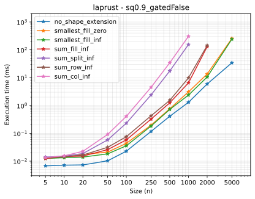 | 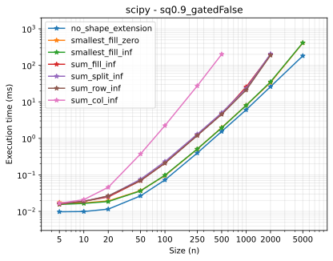 |

## 2. Cost extension — alternative cost (sink nodes)

To leave a node unmatched at cost $\eta$, we add sink rows/columns. There are 11 equivalent layouts (plus
`no_cost_extension`, i.e. the backend's native cost limit). They give the same optimum but differ in speed
and robustness.

**Findings.** `diag_row_pad_zero` is the fast, robust default for `scipy`, `lap` and `lapjv`
(`fill_row_pad_zero` is on par with its diag counter part). `laprust` has a **native** cost limit and is fastest with
`no_cost_extension` — by a wide margin. `lapsolver` prefers the split layouts (`diag_split_sparse`). Avoid
the `*_pad_inf` variants with `lapjv`: they are slower and make it return wrong assignments.

| laprust (native wins) | scipy (`diag_row_pad_zero`) |
| --- | --- |
| 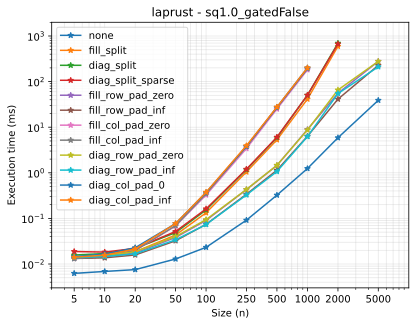 | 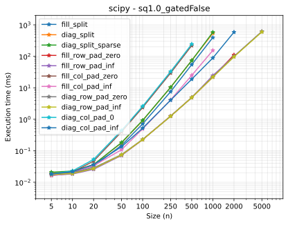 |

## 3. Sparse extension — gated / sparse matrices

The sparse backends need a sparse, fully-linkable matrix. We compare the three extensions in `pylapy.sparse`,
for both an alternative cost (`hard=False`) and a pure threshold (`hard=True`).

**Findings.** `csgraph` (scipy) handles rectangular matrices and is fastest with `diag_row_no_pad`. `lapmod`
only solves square matrices, so it must use `diag_split_sparse`. Both are correct, and sparse solving is usually
much faster than dense cost extension on thresholded problems.

| csgraph (`diag_row_no_pad`) | lapmod (`diag_split_sparse`) |
| --- | --- |
| 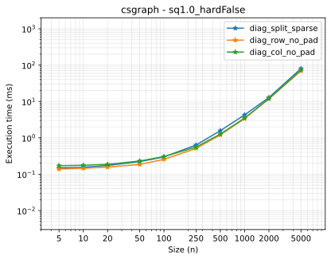 | 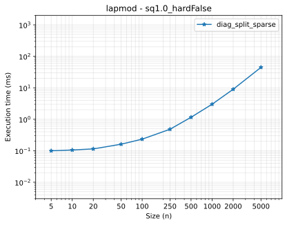 |

## 4. Method comparison

Each backend is pinned to its chosen extension (from studies 1–3) and raced on four use cases ×
three shapes:

- **full** — no threshold (plain assignment),
- **gated** — a cost limit only (`alternative_cost=inf`),
- **alternative** — an alternative cost,
- **gated_alternative** — gated + alternative cost.

**Findings (at $n = 1000$, the reliable range).**

- **full**: `laprust` is fastest (~6 ms), then `scipy` (~12 ms), with `lap`/`lapjv` behind (~50 ms) and
  `lapsolver` the slowest (~135 ms); any dense backend is fine.
- **alternative**: `laprust` (~1.3 ms) and the sparse backends (`lapmod`/`csgraph`, ~3.5 ms) dominate; the
  other dense backends (`lap`/`lapjv` ~13 ms, `scipy` ~21 ms) are ~5–15× slower, and `lapsolver`
  is far worse (~0.6 s).
- **gated** (cost limit, no alternative): the sparse backends win big (`csgraph`/`lapmod` ~4–5 ms, `scipy`
  ~5.5 ms) while `laprust`/`lap`/`lapjv` degrade badly at scale (~150–220 ms). We note that a non-default
  shape extension (e.g. `smalless_fill_inf`) may avoid this degradation specifically for gated rectangular problems.
- `lapsolver` is the slowest across the board on thresholded problems; `lapjv` can also return slightly
  sub-optimal costs there.

**Recommendation.** Use `laprust` as the dense default (great for plain assignment and for an alternative
cost via its native limit); use `sparse_solve` (`csgraph` or `lapmod`) whenever the problem is thresholded
or sparse.

### full
| $s = 0.9$ | $s = 1.0$ | $s = 1.1$ |
| --- | --- | --- |
| 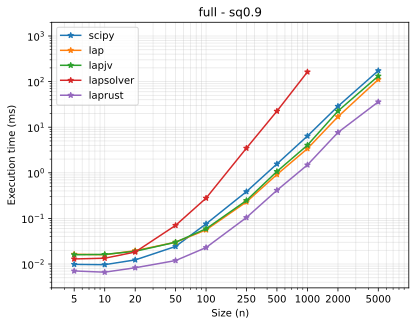 |  | 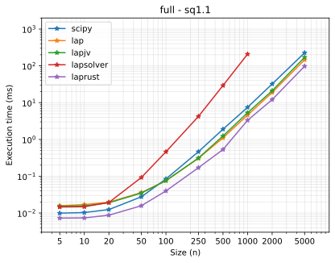 |

### gated
| $s = 0.9$ | $s = 1.0$ | $s = 1.1$ |
| --- | --- | --- |
| 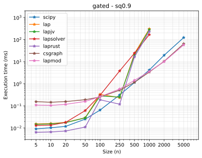 |  | 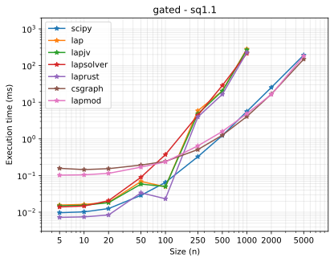 |

### alternative
| $s = 0.9$ | $s = 1.0$ | $s = 1.1$ |
| --- | --- | --- |
| 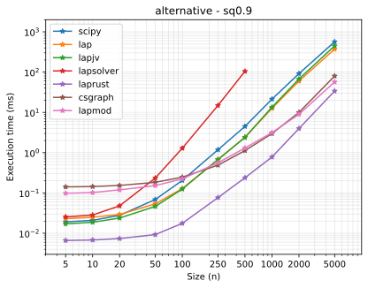 | 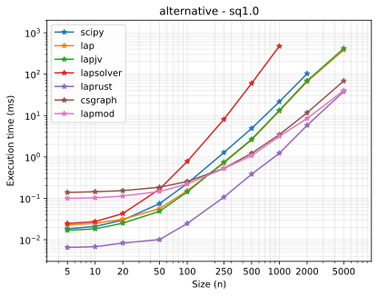 | 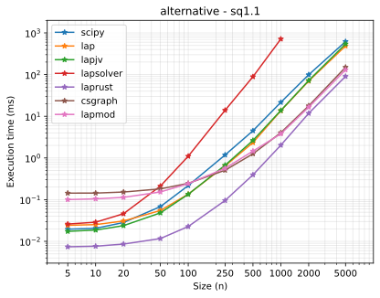 |

### gated_alternative
| $s = 0.9$ | $s = 1.0$ | $s = 1.1$ |
| --- | --- | --- |
| 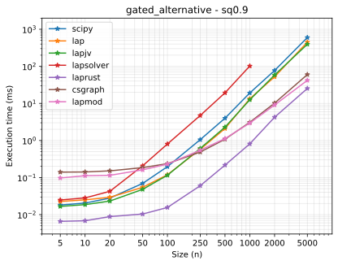 |  | 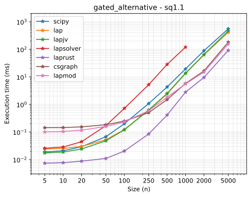 |

## Chosen defaults

These studies set pylapy's per-backend defaults (`DEFAULT_SHAPE_EXTENSIONS`, `DEFAULT_COST_EXTENSIONS` in
`src/pylapy/*_extension.py`, `DEFAULT_SPARSE_EXTENSIONS` in `src/pylapy/sparse.py`):

| backend | rectangular (shape) | alternative cost (cost) | sparse |
| --- | --- | --- | --- |
| `scipy` | internal (`no_shape_extension`) | `diag_row_pad_zero` | — |
| `lap` | internal | `diag_row_pad_zero` | — |
| `lapjv` | internal | `diag_row_pad_zero` | — |
| `lapsolver` | internal | `diag_split_sparse` | — |
| `laprust` | internal | internal (`no_cost_extension`) | — |
| `csgraph` (sparse) | — | — | `diag_row_no_pad` |
| `lapmod` (sparse) | — | — | `diag_split_sparse` |
